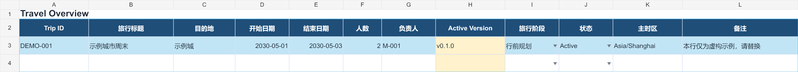
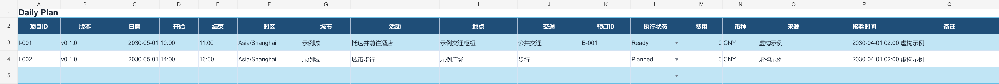
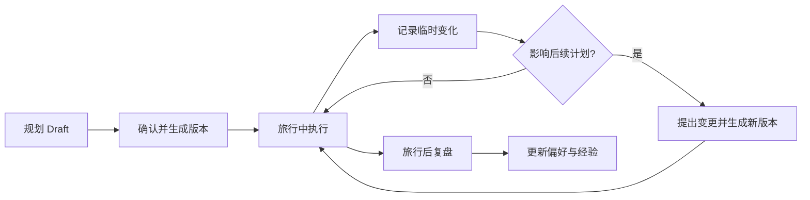

# Travel OS

[](https://github.com/tygshy97-AshAyuan/travel-os/actions/workflows/validate.yml)
[](https://github.com/tygshy97-AshAyuan/travel-os/releases/tag/v0.4.34)
[](LICENSE)

**让 AI 不再每次从零规划旅行。**

Travel OS 是一个以 Excel 为长期旅行档案的 Agent Skill。它让 AI 在规划、执行、临时调整和复盘之间持续记住同一份真实状态，同时保留每次修改的原因和版本。

> 你负责做决定，AI 负责整理、核对、提案和维护版本。

## 旅行档案长什么样





截图来自仓库中的虚构示例档案，不包含真实用户数据。

## 它解决什么

普通 AI 对话适合生成一份行程，却很难长期维护它：酒店改了，旧地址还留着；同伴提出意见，不知道是否处理；换个会话，AI 又忘了当前版本。

Travel OS 把这些信息放进一个可检查、可携带的 Excel 文件：

| 旅行中的问题 | Travel OS 的处理方式 |
| --- | --- |
| 修改后出现多个互相冲突的版本 | `Active Version` 明确唯一有效版本 |
| AI 跨会话忘记最新状态 | 每次先读取、校验并恢复档案 |
| AI 擅自覆盖已确认的信息 | 先提出变更，用户确认后再写入 |
| 多人意见散落在聊天里 | 提案有待处理、接受、拒绝、澄清状态 |
| 途中变化与正式计划混在一起 | 运行状态与正式版本分开记录 |
| 旅行结束后经验丢失 | 复盘结果沉淀到偏好和历史记录 |

## 已支持的工作流

- 从零生成 Draft，确认后激活首个版本
- 恢复已有档案并只读取 Active Version
- 通过提案修改行程，同时保留旧版本
- 记录旅行中的完成、跳过和阻塞状态
- 根据当前天气只重排受影响的未来行程，并保留确认订单和已完成历史
- 协调 Owner、同行者意见和偏好
- 从粘贴或导出的订单确认中提取事实，审核后写入
- 生成带途经点和交通方式的共享地图路线链接
- 旅行结束后复盘，并把明确反馈沉淀为长期偏好

## 5 分钟开始

1. 打开 [Travel OS v0.4.33](https://github.com/tygshy97-AshAyuan/travel-os/releases/tag/v0.4.33)，下载 `Travel-OS-Skill-v0.4.33.zip`。
2. 将这个 ZIP 安装到支持 Agent Skill 的客户端；包根目录就是 `SKILL.md`，并已包含 Excel 模板。
3. 复制 `assets/TravelOS-Template.xlsx`，填写旅行概况、偏好、已确认预订和同行成员。完整仓库包另有填写好的虚构示例。
4. 上传表格，把下面这句话发给 AI：

```text
恢复当前旅行状态。告诉我 Active Version、硬约束、已确认预订、未处理提案和下一步；先不要修改档案。
```

AI 应先校验档案，再给出当前状态摘要。新旅行从 Draft 开始；修改现有旅行时，它会先展示变更提案，得到确认后再生成新版本。

## 一次真实的使用方式

```text
我把周六上午的博物馆取消了。请结合下雨、同行者不想早起、酒店不可退这三个条件，给我两个替代方案。先展示影响范围，不要直接写入。
```

Travel OS 会区分已确认事实、用户偏好和待定建议，说明哪些日程、预订或清单会受影响。你选定方案后，它才会更新档案、记录变更原因并推进版本。

## 一份文件，覆盖完整旅行周期



Excel 模板包含 8 张工作表：旅行概况、每日计划、预订、清单、偏好、变更记录、成员和提案。它既是 AI 的上下文，也是用户随时可以打开检查的源文件。

## 设计原则

- **单一事实来源**：`Travel Overview` 中的 Active Version 是当前唯一有效版本。
- **先读后写**：每次会话先恢复状态；所有修改先成为提案。
- **事实不猜测**：预订、签证、健康、费用等关键信息缺失时必须标记未知。
- **确认后落盘**：写入失败时不得更新 Active Version。
- **隐私优先**：公开示例只用虚构数据；反馈中不要包含订单、证件或精确住宿信息。

## 仓库里有什么

- [`skill/travel-os/`](skill/travel-os/)：可安装的 Skill 与运行规则
- [`templates/TravelOS-Template.xlsx`](templates/TravelOS-Template.xlsx)：旅行档案模板
- [`templates/TravelOS-Example.xlsx`](templates/TravelOS-Example.xlsx)：使用虚构数据填写的完整示例
- [`docs/`](docs/)：用户指南、设计覆盖和反馈说明
- [`docs/client-validation.md`](docs/client-validation.md)：真实客户端安装验证记录与剩余测试边界
- [`tests/`](tests/)：Excel 与版本一致性的自动检查
- [Issues](https://github.com/tygshy97-AshAyuan/travel-os/issues/new/choose)：问题反馈和功能建议
- [Roadmap](ROADMAP.md)：当前、下一步和长期方向

## 当前状态

这是 **Early Access** 版本。Skill 已通过 Codex 的 GitHub 安装器和官方格式检查器；自动测试会检查 Skill 结构、8 张工作表、Active Version、预订引用、成员和凭据泄露等关键约束。不同 Agent 客户端的指令遵循和文件写回方式仍可能不同。

如果你愿意试用，请从一个短途行程开始。遇到问题时使用 [Bug 报告模板](https://github.com/tygshy97-AshAyuan/travel-os/issues/new/choose)，只需说明你做了什么、预期结果和实际结果。产品设计覆盖与延期项见 [`docs/design-coverage.md`](docs/design-coverage.md)。

## 参与改进

- 发现错误：提交 [Bug Report](https://github.com/tygshy97-AshAyuan/travel-os/issues/new/choose)
- 有新想法：提交 [Feature Request](https://github.com/tygshy97-AshAyuan/travel-os/issues/new/choose)
- 想参与开发：阅读 [Contributing](CONTRIBUTING.md)
- 发现安全或隐私问题：通过 [私密安全报告](SECURITY.md) 提交
- 觉得有用：点一个 Star，帮助更多旅行者看到它

## License

[MIT](LICENSE)。第三方平台名称和商标归各自权利人所有。
