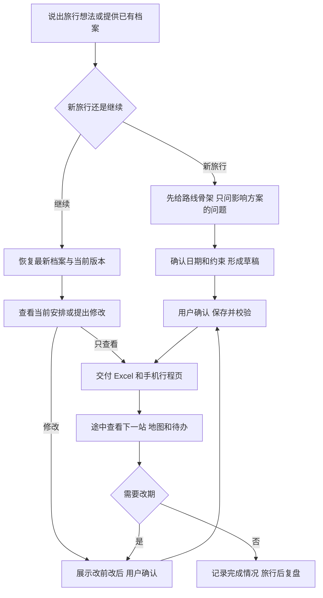

# 五分钟上手

本页适用于 v0.5.0。安装入口见 [README](../README.md#5-分钟开始)。HTML 导出与布局已有自动检查；各客户端完整对话流程和手机原生打印仍在持续验收。

## 新旅行：直接说想怎么玩

安装更新后的 Skill 后，不用先填写表格。例如：

```text
想去杭州玩三天，两个人，从上海出发，想逛街吃饭，不想早起，日期还没定。先给我一个轻松的路线骨架。
```

AI 应先给可讨论的路线，沿用已知偏好，只补问影响安排的问题。日期未定时先用第 1 天、第 2 天；这时是未保存的构思，不会伪造日期或宣称已建立旅行档案。

确定日期和必要信息后，具备文件能力的客户端由 AI 复制内置模板并建立草稿。你确认当前方案后，AI 保存、校验并交付最新 Excel。没有文件能力时，仍可讨论路线，但会说明尚未保存。

## 继续旅行：带上最新档案

上传最新 Excel，直接说：

```text
接着这趟旅行继续，先告诉我已经确定了什么，以及现在最需要处理的事。
```

AI 先恢复和校验档案，再用简短状态说明当前方案。换客户端或会话且文件无法自动延续时，需要重新提供最新档案。

## 途中：只看眼前需要做的事

确认并保存行程后，可以直接说：

```text
给我生成无需登录、手机可查看的行程文件，保留每天安排、下一段行程和版本变化。我的目的地在中国大陆，用高德地点查询；同时给我最新 Excel。
```

具备 Python 和文件交付能力时，AI 会运行内置导出器。下载 HTML 后在浏览器打开：选择日期，复制地点，或使用“打印 / 存为 PDF”。核心行程不依赖网络，地图查询需要联网；界面提供中文/英文，原始地点名称不会被自动翻译。没有执行能力时只会交付文本，不会声称生成了文件。

HTML 是只读副本，不能自动知道 Excel 已经更新。修改后需要重新导出，并核对页脚版本。手机聊天软件内置预览可能限制交互，应使用完整浏览器；真实手机兼容性仍在验收。

```text
今天下一站去哪，几点出发？如果下雨怎么办？
```

AI 应给下一段行动、当地时间、交通缓冲和备选。改变后续行程时，先展示变化影响，你确认后再保存新版本。

## 回来后：留下下次能用的经验

```text
这次最喜欢沿河慢逛，博物馆排太密了。帮我复盘，并整理下次可以沿用的偏好。
```

AI 核对实际完成情况，将你明确表达的反馈存进档案。下次复用需要能读到这些偏好；并不代表所有客户端都自动记住你。

公开反馈时不要上传原旅行档案。用虚构地点和日期复现问题即可。

## 现在的用户动线



当前主要验收顺序：中国用户国内游 → 中国用户出境游 → 英文用户来中国 → 英文用户海外旅行。地图按目的地选择，入境要求按实际证件与路线核实，不能从语言推断国籍。
